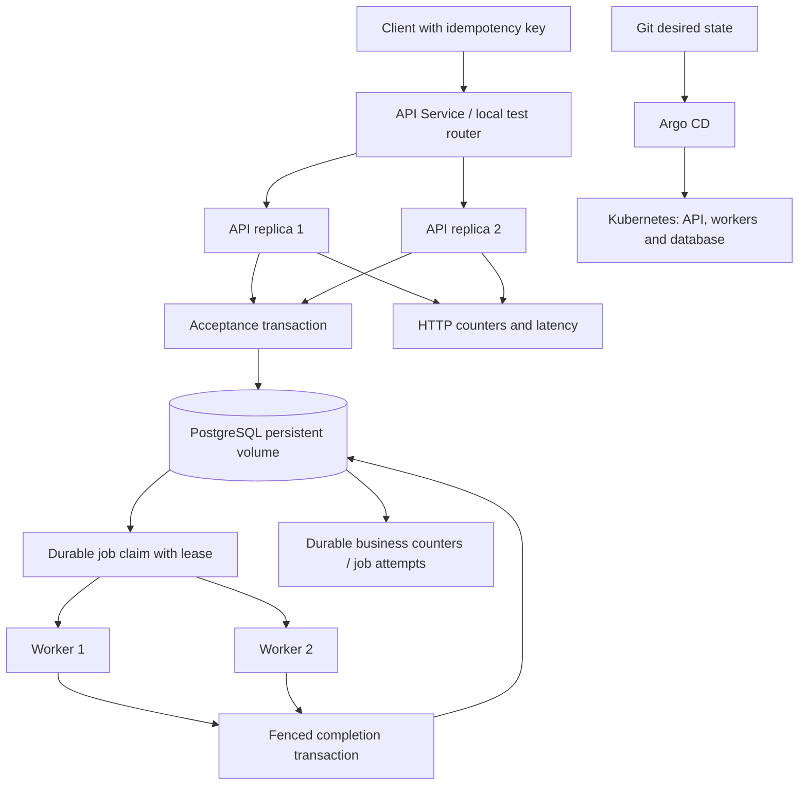

# Architecture

Status: API and worker implemented and tested locally through Part 3; CI, containers and Kubernetes/GitOps remain planned. Scope: required order API, durable asynchronous worker, atomic inventory, two API replicas and two workers. PostgreSQL is the single authoritative store. No frontend or external payment/shipping integration is required.

## Request and processing flow

1. Bound the incoming body to 16 KiB while reading, independently of Content-Length; decode JSON and validate exact contract types and errors.
2. Validate each original line, then aggregate quantities by SKU. Normalize customer ID and aggregated items without trimming or changing customer text; sort SKUs and JSON object keys for a stable comparison representation.
3. Begin an explicit PostgreSQL READ COMMITTED transaction. Insert the unique key and pending order relationship as described in ADR-001. A competing identical key waits on that database uniqueness decision.
4. For a new key, lock all requested product rows in sorted SKU order, validate all available quantities, then reserve all lines. Persist order items, price snapshots and one job in the same transaction.
5. Commit, then return 202 with a stable order ID and queued receipt. The handler never waits for worker completion. A worker may race with network delivery after commit; the receipt remains queued by contract.
6. Each separate worker claims available work or expired work using a locked row, issues a new claim token, increments attempts and commits the claim.
7. Processing occurs outside the claim transaction. Completion locks and rechecks ownership, unexpired lease and token before atomically writing the single completion receipt and final states.
8. On errors, persist sanitized attempt outcome and retry time or terminal failure. On worker death, reclaim after the lease expires. See ADR-001 for retry exhaustion during crashes.

## Boundaries and operation

- Liveness checks only the API process; readiness checks database connectivity and required migration version.
- Process-local counters may measure HTTP traffic but never authorize orders or stock. Durable order/job records support business counters across replicas; do not sum duplicate global counters exported by each API.
- Histograms use bounded labels such as method, route template and status. Observed p95 must identify workload, sample count and environment.
- Local Compose provides API, worker and database; race tests explicitly use two APIs/two workers. Kubernetes uses two replicas of each application role and persistent database storage.
- One application image, distinct entry commands. Non-root runtime; migration credentials are separate from runtime credentials.
- GitHub Actions gates tested immutable artifacts. Argo CD reconciles committed manifests. Readiness and deployment progression checks gate promotion; Argo health alone is not an image publication policy.
- Exactly-once scope is the PostgreSQL completion effect. An external service would require its own idempotency protocol; it is outside this project.

## Invariant to mechanism to proof

| Invariant | Proposed mechanism | Planned proof |
|---|---|---|
| Stock is nonnegative | Product row locks, all checks before writes, CHECK constraint | Competing-key race, stock SQL |
| No partial order reservation | One acceptance transaction | Multi-item insufficient-stock rollback |
| Same key creates one order | Unique key plus transactional insert/conflict branch | Eight calls across two APIs, one ID |
| Replays do not decrement stock | Persisted canonical payload and original order reference | Replay before/after completion and restart |
| Accepted orders survive death | Durable transaction and persistent volume | API/worker/container restart |
| One completion effect | Unique completion receipt, claim-token/lease fencing | Two workers and stale-owner test |
| Interrupted jobs recover | Expiring leases and reclaimable persisted jobs | Kill worker during processing |
| Retries stop | Persisted attempts and maximum; terminal crash recovery | Poison and repeated-crash exhaustion |
| Failed jobs retain reservation | Failure transition never edits products | Failed order and inventory SQL |

API and worker proofs are recorded in `evid/02-api/` and `evid/03-worker/`. Deployment and operational proofs remain planned.
