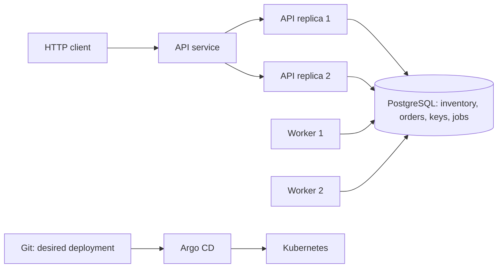

# FulfillOps — Solo Project Implementation Proposal

## Project view

**Project root:** `/Users/ferasmich/Documents/Feras/EPITA/DevOps/ROP`. All project-relative paths resolve from this folder.

Build a resilient order-processing platform from an empty repository. One developer owns architecture, application development, testing, infrastructure, operations, documentation and verification. Work proceeds in small, verifiable stages, with evidence captured throughout implementation.

This is a solo execution plan. The supplied assignment specifies teams of 2–3; solo submission and any assessment adjustments must be agreed with the instructor. The technical scope below retains the assignment's requirements. Two API replicas and two worker instances are still required: these are running processes, not people.

**Current status:** Part 1 preparation and design completed: local tool checks, Git initialization, project layout, architecture/ADR, logical schema, threat model and acceptance checklist. See `docs/environment.md` and `evid/01-design/`. Dependency locking and executable migrations are scheduled for Part 2. No application, pipeline, deployment or runtime correctness test is claimed as complete.

**Source pack:** `FulfillOps_9_5_STUDENTS_COMPLETE/` (inside the current project root).

**Source documents:** `FulfillOps_Assignment_EN.md`, `API_CONTRACT_EN.md`, `SETUP_AND_SUBMISSION_EN.md`, `fulfillops_public_checker.py`, and `fulfillops_rollout_probe.py`.

**Proposed deadline in the brief:** 15 November 2026, 23:59 Europe/Paris, subject to instructor confirmation. The brief estimates 40–55 total team-hours, including six supervised hours; treat this as an initial workload reference, not a proven solo estimate. Reassess feasibility after the first working application slice.

## Proposed architecture and scope

Use Python for the API and worker, PostgreSQL for authoritative inventory, orders, idempotency and a durable work table, Docker Compose for local execution, GitHub Actions for CI, and kind with Argo CD for Kubernetes/GitOps. Record and justify exact framework and dependency choices in ADR-001 before implementation.

Use one shared application image with separate API and worker commands if this keeps the build simple. A PostgreSQL work table avoids introducing another durable service. Document job claiming, leases/recovery, bounded retries and transaction boundaries explicitly.



Mandatory invariants:

- Available inventory is never negative; multi-item reservations are all-or-nothing.
- One idempotency key maps to at most one accepted order across all API replicas.
- An accepted order, its reservation, idempotency mapping and durable work commit atomically.
- Replays do not reserve stock again, including after restarts.
- At-least-once job delivery produces an exactly-once completion effect.
- Worker crashes do not erase committed orders.
- Exhausted retries produce an auditable failed/operator-review state; stock is retained for manual reconciliation.

## Solo working method

1. Work on one main implementation stage at a time; keep each change reviewable.
2. Define the acceptance check before implementing the stage.
3. Capture commands and real output as work happens, including failures and fixes.
4. Self-review the change against the API contract and invariants before moving on.
5. Keep incremental history and PR-based CI evidence. Record self-review accurately; do not imply another reviewer participated.
6. Prepare to explain every component in the individual defense.

## Step-by-step implementation

### Part 1 — Preparation and design

1. Verify Git, Docker/Compose, Python, kubectl and kind; record versions and Docker availability.
2. Establish the repository layout, dependency management and secret exclusions.
3. Translate the contract into an acceptance checklist, including exact status/error codes and edge cases.
4. Design inventory, orders, order items, unique idempotency mapping and durable jobs.
5. Specify reservation locking, payload normalization, job ownership, recovery and retry policy in ADR-001.
6. Write the architecture diagram and at least five realistic threats with mitigations.

**Deliverables:** `docs/architecture.md`, `docs/ADR-001.md`, `docs/threat-model.md`, schema/migrations and contract checklist.

**Exit check:** every invariant has a proposed database mechanism and a planned test.

**Evidence:** `evid/01-design/`.

### Part 2 — API and atomic order acceptance

1. Implement migrations and safe isolated-test seeding: KIT-100 = 7 units at 1299 cents, PART-200 = 12 at 599 cents, PACK-300 = 5 at 249 cents.
2. Implement liveness, readiness, catalog, inventory, order creation, order lookup and metrics routes.
3. Enforce the contract's request validation, error objects and 16 KiB body limit. Reject boolean quantities.
4. Aggregate duplicate SKU lines before reservation and total calculation.
5. Atomically reserve all stock and persist the order, key mapping and durable work. Return 202 after commit.
6. Return the same order ID and queued acceptance receipt on identical replay, even after completion. Reject conflicting payloads with 409 IDEMPOTENCY_CONFLICT.
7. Verify that restarts preserve orders, keys and spent inventory; startup must not reseed spent stock.

**Exit check:** basic acceptance and replay work; transaction failures leave no partial allocation.

**Evidence:** `evid/02-api/`, including HTTP output and sanitized database queries.

### Part 3 — Worker and durable recovery

1. Implement a separate worker process with atomic job claiming.
2. Run two workers and prevent concurrent application of the same completion effect.
3. Implement interrupted-job reclamation, bounded retries and backoff.
4. Persist failed/operator-review state when attempts are exhausted; retain reserved stock.
5. Verify normal completion within the contract's 15-second healthy-local expectation.
6. Kill a worker during a committed order; prove another worker recovers it exactly once.
7. Inject a deterministic poison job in the isolated lab; show attempts stop at the configured limit.

**Exit check:** both crash recovery and bounded poison-job handling are reproducible.

**Evidence:** `evid/03-worker/`, including order IDs, attempt counts, state queries and worker logs.

### Part 4 — Tests and cross-replica concurrency

1. Add unit tests for validation, prices, normalization and retry decisions.
2. Add integration tests for transaction rollback, persistence and competing job claims.
3. Create an owned race test with at least 12 concurrent competing-key requests for limited stock.
4. Create a separate owned test with eight simultaneous identical-key requests across two API instances. Record proof that both instances participated.
5. Verify one stable order ID and one reservation; test competing keys for remaining stock.
6. Test duplicate SKU aggregation, replay after an API restart and readiness during database failure.
7. Preserve a deliberately failing regression test and its repaired passing run.
8. Run the supplied checker with both flags on a freshly seeded isolated dataset.

**Exit check:** owned tests pass and the public checker reports 15 passed / 0 failed / 0 skipped. The public checker alone does not prove cross-replica routing or operational recovery.

**Evidence:** `evid/04-tests/`.

### Part 5 — Containers and reproducible local operations

Start a minimal Compose stack during Parts 2–3; finish hardening here.

1. Create multistage, non-root images with explicit dependency versions and minimal runtime contents.
2. Add `.dockerignore`, `compose.yaml`, health checks, persistent storage and `.env.example` placeholders.
3. Document startup, migrations, test seeding and shutdown without data destruction.
4. Implement a reset command that refuses non-test targets.
5. Verify a clean build, healthy services and persistence across restarts.
6. Inspect the container user and compare image size with a documented naive baseline.

**Exit check:** a clean checkout can start the local stack using documented commands.

**Evidence:** `evid/05-containers/`.

### Part 6 — CI/CD and supply-chain controls

1. Configure PR-to-main workflows for lint/static checks, owned tests and both public-checker modes against an isolated stack.
2. Build images and run vulnerability scans; document blocking versus informational findings.
3. Generate a machine-readable SBOM for the built image and preserve it as a CI artifact.
4. Use least-privilege permissions and pinned action versions or reviewed release tags.
5. Gate publication/promotion on required checks; publish accepted artifacts with immutable SHA tags and record digests.
6. Demonstrate a red pipeline that blocks promotion and the corrected green run.

**Exit check:** a critical failure actually prevents promotion; the accepted image has traceable SBOM and scan results.

**Evidence:** `evid/06-ci/`, including downloaded artifacts and CI/PR URLs. Publishing or submitting remains a separate authorized action.

### Part 7 — Kubernetes and GitOps

1. Create a disposable kind cluster and document versions.
2. Create namespace-scoped manifests for two API replicas, two workers, Service, ConfigMap, Secret references and persistent database storage.
3. Add probes, resource requests/limits and a rolling-update strategy that maintains availability.
4. Install a pinned Argo CD version and connect the real repository using credentials managed outside Git.
5. Reconcile to Synced and Healthy; record pods, controllers, storage and image references.
6. Demonstrate manual drift and GitOps correction; explain self-healing and approval decisions.

**Exit check:** two APIs and two workers operate successfully under Git-managed desired state.

**Evidence:** `evid/07-gitops/`.

### Part 8 — Observability, rollout and incident recovery

1. Implement safe structured logs and the four required counters: orders created, orders failed, worker retries and HTTP requests.
2. Add latency measurements sufficient to calculate p95.
3. Collect at least 200 HTTP samples; retain raw data, calculation and environment details. Distinguish observed results from SLO targets.
4. Begin the supplied 30-second readiness probe before a known-good rolling update and preserve the CSV.
5. Inject a broken API revision/readiness configuration in a separate drill; show unhealthy progression and halted promotion.
6. Restore a known-good Git revision through Argo CD and verify no committed-order loss.
7. Assemble the worker-crash drill from Part 3 as the other required controlled failure, with before/during/after observations.
8. Write a blameless postmortem with timeline, root cause, mitigation, rollback/fix-forward rationale and prevention action.

**Exit check:** healthy rollout, halted unhealthy rollout and GitOps restoration have reproducible evidence. The default 30-second probe yields about 120 samples, so it does not alone meet the separate 200-sample requirement.

**Evidence:** `evid/08-reliability/`.

### Part 9 — Final verification and submission preparation

1. Reproduce the documented setup from a clean checkout.
2. Run the final checker against a fresh isolated test dataset and preserve the complete result.
3. Audit evidence coverage against every assignment requirement and the four hard gates below.
4. Finish README installation/teardown instructions and a solo contribution note describing implementation, self-review, verification and future improvements.
5. Maintain `docs/assistance-log.md` as required by the course: disclose actual external-code and AI assistance accurately without attributing the entire project to AI.
6. Prepare the report, maximum eight pages, and demo, maximum 15 minutes.
7. Verify repository access for the instructor and prepare CI links, image digest, SBOM, scans, race results, recovery logs and rollout CSV.
8. Rehearse the individual defense across architecture, code, unfamiliar failures, security, CI and GitOps.

**Exit check:** every completion claim links to real evidence. Unverified or incomplete requirements are explicitly listed.

**Evidence:** `evid/09-final/`. Keep canonical report/demo artifacts here and link from README.

## Evidence policy — everything under evid/

All verification evidence belongs under `evid/`, including terminal commands and output, HTTP responses, sanitized SQL results, test reports, CI logs/artifacts, screenshots, CSV samples, image references, incident observations and final report/demo. Source files and maintained design documents remain in their normal project directories; their verification snapshots and references go in `evid/`.

```text
evid/
  README.md
  INDEX.md
  01-design/
  02-api/
  03-worker/
  04-tests/
  05-containers/
  06-ci/
  07-gitops/
  08-reliability/
  09-final/
```

For each run, use a unique directory such as `evid/04-tests/20261110T150000Z_same-key-race/` and store:

- `context.md`: requirement, purpose, UTC start/end, commit SHA, working directory, tool versions, environment, exact reproduction commands, expected result, observed result and limitations.
- `commands.txt`: exact sanitized terminal commands, in execution order.
- `terminal.log`: actual stdout/stderr, command boundaries and recorded exit status for every command. Preserve failures.
- Relevant original artifacts: JSON/XML test reports, CSV, screenshots, sanitized database results, CI/SBOM/scan files and logs.
- `links.md` when applicable: PR/run/artifact URLs and immutable image references. Download essential artifacts before remote retention expires.

Record pipeline command failures correctly when collecting output; a successful logging command must not hide a failed test. Capture a separate exit code for the command being assessed. A failure expected during a drill must be labeled as expected, with recovery evidence linked.

Do not overwrite a failed run with a successful run. Cross-link both in `evid/INDEX.md`. Screenshots supplement machine-readable logs. Never fabricate results or use a proposed command as proof it ran. Capture only safe output; avoid commands that expose secrets, and sanitize sensitive data before saving or sharing.

The assignment suggests some evidence under `docs/`. This proposal centralizes it under `evid/`; explain that layout in README and link to it from the relevant docs. For example, put the rollout CSV under `evid/08-reliability/` and link it from the postmortem.

## Four hard completion gates

| Gate | Required proof | Evidence location | Current status |
|---|---|---|---|
| Cross-replica idempotency | Eight identical concurrent requests across two APIs; one order/reservation; replay survives restart | `evid/04-tests/` | Not run |
| Worker resilience | Two workers; killed worker recovery exactly once; bounded poison-job attempts and retained failed state | `evid/03-worker/` | Not run |
| Safe delivery | Healthy 30-second rollout, halted unhealthy rollout, known-good GitOps restoration, no order loss | `evid/08-reliability/` | Not run |
| Supply-chain quality gate | CI-produced SBOM, scan policy, red-to-green proof, blocked promotion and immutable image reference | `evid/06-ci/` | Not run |

## Suggested solo sequence

Use the following as execution checkpoints rather than guaranteed durations:

1. Design and first vertical slice: one accepted order persists and a separate worker completes it.
2. Correctness: atomic reservations, idempotency, two APIs and two workers.
3. Recovery: owned race tests, worker death and poison jobs.
4. Reproducibility: hardened Compose and CI/SBOM/gates.
5. Operations: Kubernetes, Argo CD and drift correction.
6. Reliability proof: latency samples, healthy/broken rollouts and restoration.
7. Delivery: clean-checkout verification, evidence audit, report, demo and defense.

Start evidence capture on the first day. All advanced requirements remain mandatory; sequencing changes do not make them optional.
